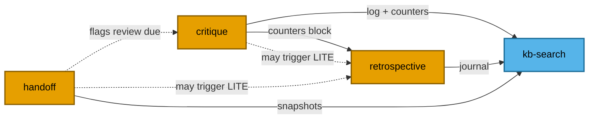

# instrumented_skills

[](https://github.com/AdiMendelowitz/instrumented_skills/actions/workflows/ci.yml)
[](LICENSE)

**Five Claude Code skills that write their state to disk and read it back before acting,
so the next session starts from what the last one settled.**

Work that spans many sessions loses its decisions. A week later, a plan that was only
proposed reads exactly like one that was agreed, and a defect found on Monday gets found
again on Thursday. Each skill here covers one place where that happens (a review, a
retrospective, a handoff, a search and the end of a session) and fixes it the same way,
with a log that the next run reads first.

## Quick start

```bash
git clone https://github.com/AdiMendelowitz/instrumented_skills
cd instrumented_skills
./install.sh                    # macOS and Linux: copies all five skills to ~/.claude/skills/
```

```powershell
.\install.ps1                   # Windows
```

Then open Claude Code in any project and run `/critique README.md`. Run it a second time
after you change the file, and the review starts from the first run's log.

## The skills

| Skill | What it does | Run it with |
|---|---|---|
| [`critique`](critique/) | Reviews one file through a fixed set of lenses and logs every finding. The next run on the same file reads that log first and marks each finding fixed, still present or withdrawn. | `/critique <file> [purpose]` |
| [`retrospective`](retrospective/) | Turns a journal of marked lines into a retro where every finding needs a quote, a line or a named absence behind it. Capture is typed by hand or runs from a Stop hook. | `/retrospective run <slug>` |
| [`handoff`](handoff/) | Writes an end-of-session snapshot in eight labelled sections that keep decisions apart from suggestions, with a linter that checks the snapshot. | `/handoff [next objective]` |
| [`kb-search`](kb-search/) | Ranks the logs, journals and snapshots the other three write with BM25, using the Python standard library and no model call. | `/kb-search` |
| [`close-session`](close-session/) | Runs retrospective, critique and handoff as one end-of-session pipeline, then writes the prompt that opens the next session. | `/close-session` |

Each skill works on its own. The reasoning behind them, one post per skill, is on the
blog: [Skills That Remember](https://blog.adimendelowitz.dev/skills/intro.html).

## How the skills connect

Three skills write durable records (critique logs, retro journals and handoff snapshots),
and `kb-search` is the shared way to read them back. Solid arrows are records written and
read later, and dashed arrows are trigger signals. Orange nodes write records and the blue
node reads them.



<details>
<summary>How each connection works</summary>

- `kb-search` reads what the others write. `critique` already reconciles a file against
  its own last log entry, and `kb-search` lets a run ask whether the same root cause fired
  on any *other* file. A retro can check whether a long-horizon action was ever done, and
  a handoff can search earlier snapshots for what a past session settled. Its own
  `references/search_policy.md` decides when to grep first and when to escalate to a
  ranked search.
- Every `critique` log entry carries a `counters` block (calls, cap, bytes, output
  characters, a severity histogram, new findings and carried findings) and a top-level
  `promoted` flag. The finance lens in `retrospective` can cite that block as evidence
  when it anchors a cost finding.
- `retrospective` has a LITE path that a review or handoff skill can trigger when its own
  condition fires, such as a review that closes a project or a handoff that records the
  same pattern for the third time. `handoff` ends by running a review skill on the
  snapshot itself, so a session that closes with open SEV1 or SEV2 issues states them.

Every connection is read-only and optional. `critique` works alone, and `retrospective`
falls back to timestamps when no counters data exists.

`close-session` sits outside the diagram because the records it leaves come from the three
skills it runs. It runs the `retrospective`, `critique` and `handoff` protocols in sequence (a retro, a critique
of that retro, an independent verification pass that writes the handoff) and then builds
the next session's opening prompt from their output.

</details>

## Optional hooks and tests

| Skill | Optional extra | Without it |
|---|---|---|
| `retrospective` | A Stop hook, `scripts/retro_capture.py`, that captures marked lines from each session | You type the marked lines yourself (LOG mode) |
| `handoff` | A UserPromptSubmit hook, `tools/session_watch.py`, that counts turns and says when to write a handoff | You decide when the session is long enough |
| `close-session` | `retrospective`, `critique` and `handoff` installed beside it | It runs each missing phase inline at reduced quality and says so |

A hook runs automatically once it is registered in `settings.json`. The retrospective
README shows its registration, and `handoff/CLAUDE_md-snippet.md` shows the handoff one.
The Python tools use the standard library only. CI runs the `handoff` and `kb-search` test
suites on every push with Python 3.13, and you can run them with `python -m pytest -q` in
each `tools/` folder. `retro_capture.py` has no test suite yet.

## Where files go

Documents (retros, handoffs and session-start prompts) go to a notes folder that your
project's `CLAUDE.md` names under a "Where internal files live" heading. Without that
heading, a skill asks once and then creates `notes/`, or `data/notes/` when `data/` is
gitignored. Logs, journals and other skill state go under the project's `.claude/` folder.

## Other ways to install

```bash
./install.sh critique kb-search                 # only the skills you name
.\install.ps1 -Skills critique,kb-search        # the same on Windows
cp -r critique ~/.claude/skills/                # by hand, one folder per skill
```

The install scripts archive any existing copy of a skill before they replace it. On a
hosted chat surface with project instructions, upload the skill folder or paste its
`SKILL.md` and references into the project.

## Adapting to your setup

Each skill's README has an "Adapting this skill" section for the parts that depend on
your environment, such as where logs live and how to add a lens. The mechanism of logging,
reconciling and never re-deriving transfers as it is, and every path or project name that
needs changing is marked where it appears.

## Author and support

Written by [Adi Mendelowitz](https://adimendelowitz.dev). Open a GitHub issue for bugs or
questions. MIT licence, see [`LICENSE`](LICENSE).
