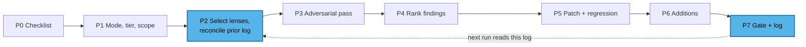

# critique

**A file review that reads its own last log before it starts, so the second pass reconciles
what the first one found.**

`critique` reviews one file at a time, whether a document, a prompt or a code file, through
five lenses that always run plus a bundle chosen by the file's type. Every run appends a
log line, and the next run on the same file reads it first, so each earlier finding comes
back marked FIXED, STILL-PRESENT or WITHDRAWN. Patches land in a versioned copy beside the
file, and the log records whether that copy was promoted over the original, so an
unapplied patch is carried forward as still present.

| | |
|---|---|
| Protocol | v2.10, eight stages (P0 to P7) |
| Run it with | `/critique <file> [purpose]` |
| Lenses | 5 always on (purpose, evidence, falsification, pre-mortem, red team) plus one bundle per file type |
| Depends on | nothing |

## Quick start

```bash
cp -r critique ~/.claude/skills/          # or ./install.sh critique from the repo root
```

In Claude Code, run `/critique docs/plan.md "a plan the team can execute this week"`. The
reply opens with a five-line summary, then the findings table, the patched copy
(`plan.v2.md`) and the command that promotes it. On a hosted chat surface with no
persistent filesystem, paste `SKILL.md` and the bundles you need into the project
instructions.

## The pipeline

P7 writes the log entry that P2 reads on the next run against the same file, which is the
memory loop highlighted in blue.



The tier sets the budget. A single file under 300 lines gets 5 tool calls and at most 8
findings, and six or more files get 20 calls and 18 findings. A run that reports no
defect is a valid result, and the protocol says so explicitly so that a model under
pressure to look thorough has no reason to invent findings.

## Adapting this skill

### Where the log lives

With a persistent filesystem and a repository (Claude Code, or Cowork with a checkout),
the log is `${CLAUDE_PROJECT_DIR}/.claude/critique-log/<slug>.jsonl`, one file per target.
On a hosted chat surface the log lives in memory, with one general index for targets that
span projects and a project index for targets that belong to one project. Decide the split
once per installation, and give a project its own index only when it has enough critique
history to make reconciliation across sessions worth it.

### Applying every finding

By default the skill patches SEV1 and SEV2 findings and sends SEV3 to the backlog. To have
it apply SEV3 and accepted additions on every run, add a standing fix-everything line to
the project's `CLAUDE.md` or the equivalent always-loaded config, which the skill reads at
P5. Without that line, ask for it in the invocation.

### Lenses and bundles

Each bundle file is a self-contained set of lens definitions, so you can add, remove or
reword one without touching the others. Add a signature row to the P2 table in `SKILL.md`
when you introduce a new file type. The five always-on lenses are never dropped, so keep
them off the list of lenses that can be dropped at the cap.

## Regression testing

When you change `SKILL.md` or a bundle, run a fixed set of files through the old and the
new version and compare the two. `evals/README.md` describes the three cases that catch
most regressions (a clean document, a document with two planted defects and a file with
an unpromoted prior log entry), and `evals/evals.json` holds three more cases with their
fixtures. `evals/results-2026-10.md` records one run of each, graded by the run itself, on
an earlier protocol version, and some checks test the skill's own output format.

## Files

```
SKILL.md                     the protocol: stages P0 to P7, tiers, budgets, log schema
code.md                      lens bundle for source files
docs.md                      lens bundle for prompts and process documents
systems.md                   lens bundle for architecture and design docs, with a finance section
ml.md                        lens bundle for model and analytics write-ups
multifile.md                 lens bundle for documents that reference each other
evals/README.md              the regression-testing method
evals/evals.json             three ready cases, fixtures in evals/fixtures/
evals/results-2026-10.md     one run per case, with and without the skill, on an earlier version
```
