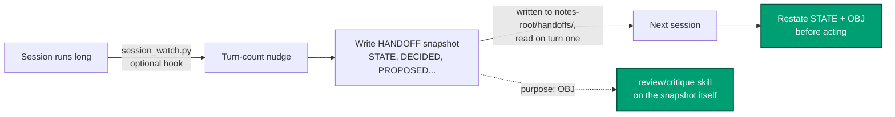

# handoff

**A schema for the end of a session, so "here's where we left off" can be checked.**

`handoff` writes a session's state as a structured snapshot that the next session reads on
its first turn. Prose lets a decision you made and a suggestion you liked read the same, and a few
sessions later a plan nobody committed to starts being treated as settled. The schema
keeps them in separate labelled sections, and a linter checks the snapshot against the
rules.

| | |
|---|---|
| Protocol | v3.4, eight labelled sections, pipe-delimited fields, no prose |
| Run it with | `/handoff [next objective]` |
| Toolkit | `tools/measure_savings.py` (lint, state check, compare) and `tools/session_watch.py` (optional session-length hook) |
| Tests | 55, run with `python -m pytest -q` in `tools/` |
| Depends on | nothing; pairs optionally with `critique` and `retrospective` |

## Quick start

```bash
cp -r handoff ~/.claude/skills/            # or ./install.sh handoff from the repo root
```

At the end of a session in Claude Code, run `/handoff "finish the parity report"`. The
snapshot goes to `handoffs/` in your notes folder (see [Where files go](../README.md#where-files-go)),
and the next session reads it on its first turn. `example-handoff.md` is a sanitised worked
example that passes the linter.

## From a long session to a correct first turn

The two green nodes are where each loop closes.



The next session restates the state it read before it acts, and a review skill checks the
snapshot itself, so neither side trusts the format alone.

## The schema

```
STATE          <=8 lines: paths (with version + line/byte counts), then installs, then running processes
DECIDED        <=10 lines: things actually committed to (a liked suggestion stays in PROPOSED)
PROPOSED       <=6 lines: suggestions on the table, not yet committed
REJECTED       <=5 lines: options considered and dropped, with why
OPEN           <=5 lines: questions blocking a specific next step, naming what they block
UNVERIFIED     <=5 lines: claims carried forward that were never independently rechecked
PATTERN        <=3 lines: recurring corrections, with an occurrence count
FIRST          1 line: the exact next action, specific enough to execute directly
```

Every section is a set of labelled, pipe-delimited lines. `SKILL.md` has the exact line
shape for each section and the full rule set.

## Why this shape

DECIDED and PROPOSED carry the most weight. Once an idea lands well in conversation it is
tempting to write "we're doing X", which merges a firm commitment with an option that was
merely well received. The protocol tells the author to err towards PROPOSED and to mark an
unclear origin as `origin-uncertain`.

UNVERIFIED exists for long sessions. Past roughly 30 turns, `SKILL.md` requires a line
stating that the snapshot was written under context degradation, and
`tools/measure_savings.py --lint` checks that the line is there.

PATTERN makes handoffs add up across a project. Where a review skill keeps a findings log,
reading it for defects that recur across two or more runs gives cross-session pattern
detection from a log that already exists.

## measure_savings.py

The protocol makes two claims it cannot check by itself. It estimates "30 to 40 percent
fewer tokens than prose" and labels that unmeasured, and it tells the author to compute
STATE's line and byte counts and never estimate them. `measure_savings.py` checks both, plus
the structural rules the protocol states. No measured saving is published here yet, so
treat the 30 to 40 percent estimate as unverified until `--compare` has run on your own
snapshots.

```bash
cd tools
python -m pytest -q                          # pip install pytest first if you need it

# Section caps, a single FIRST line, header shape and the long-session UNVERIFIED rule
python measure_savings.py your-handoff.md --lint

# Recompute STATE's line and byte counts from the files on disk and flag any drift
python measure_savings.py your-handoff.md --state-check --base-dir /path/to/project

# Measure the saving against a prose recap of the same content (both use one fixed
# characters-per-token constant, which gives a comparable estimate; a real tokeniser count is more exact)
python measure_savings.py your-handoff.md --compare prose-equivalent.md
```

`--state-check` verifies the path rows in STATE (those with a version and `<n>L <n>B`).
Install and process rows have nothing on disk to check, so it skips them.

## session_watch.py

A `UserPromptSubmit` hook that counts turns in code and states the count at 25 turns and
again at 35, so you know when to write a handoff and start fresh. A `CLAUDE.md` rule alone
cannot do this, because the assistant has no turn counter and its sense of elapsed
conversation is the faculty that degrades as a session grows. The hook detects, and
`CLAUDE.md` says what to do once the signal arrives.

Four constraints from the [Claude Code hooks reference](https://code.claude.com/docs/en/hooks)
shaped the code:

- The hook prints plain text, which Claude Code adds to the context on this event. Stdout
  that fails to parse is dropped, so plain text is the safer channel.
- Every message is a statement of fact. The reference warns that text framed as a system
  command can trip prompt-injection defences, so the instruction itself lives in
  `CLAUDE.md`.
- The hook stays well inside its 30-second timeout. It prefilters transcript lines by
  substring before parsing any JSON, and it exits without opening the file once its last
  threshold has fired.
- The transcript lags the live conversation, so the count is a floor and every message
  says "at least".

It runs on `UserPromptSubmit` because that event adds the hook's output to the context
before the model answers, while a `Stop` hook runs after the reply has been written.

```bash
# Check the install with a real transcript path, since a working hook and a broken one
# both stay silent until turn 25
echo '{"transcript_path":"/path/to/transcript.jsonl","session_id":"test"}' \
  | HANDOFF_WARN_TURNS=1 python3 tools/session_watch.py
```

Claude Code writes transcripts under `~/.claude/projects/<project-slug>/*.jsonl`, and any
real one works. The placeholder path above gives the same silent exit as a broken install.

> [!NOTE]
> The hook fails open on every error path (malformed input, a missing transcript, an
> unwritable state directory), because a hook that raises could block prompt submission.
> The same property makes silent failure possible, which is why `CLAUDE_md-snippet.md`
> ships a verification command and says when to run it again.

## Lessons from using it

- Savings figures were stated without measurement across several sessions. This skill's
  own "30 to 40 percent, unmeasured" line was one of them, and `--compare` exists to turn
  it into a number.
- Review rules were applied to other files while the reviewer's own output went unchecked.
  When this skill's example snapshot was finally linted, it failed twice, with an invalid
  `session-length` value and a three-line FIRST against a cap of one.
- Wrapper code got less scrutiny than the payload, and two installer defects shipped that
  way. The hook counts as wrapper code, so its tests cover the failure paths (malformed
  stdin, a missing transcript, an unwritable state directory) more heavily than the
  normal path.
- A journal-capture Stop hook in another skill failed silently and was noticed only when a
  downstream file showed a stale date. Any hook that fails open now ships with an explicit
  verification step.
- Two proposals surfaced twice without being applied: write the snapshot about two-thirds
  of the way through a session, and have the next session restate STATE before acting.
  Both are now rules in `SKILL.md`.
- A handoff transfers state and leaves judgement to the review step, so authoring it with
  several personas multiplied tokens without adding content. The schema is what made it
  work.

## Files

```
SKILL.md                        the protocol
example-handoff.md              a sanitised worked example that passes measure_savings.py --lint
CLAUDE_md-snippet.md            session-length set-up: config, hook registration, verification
tools/measure_savings.py        lint, state check, compare
tools/session_watch.py          UserPromptSubmit hook: turn counting and handoff signals
tools/test_measure_savings.py   23 tests
tools/test_session_watch.py     32 tests
evals/evals.json                three regression cases, fixtures in evals/fixtures/
evals/results-2026-10.md        one run per case, with and without the skill, on an earlier version
```
