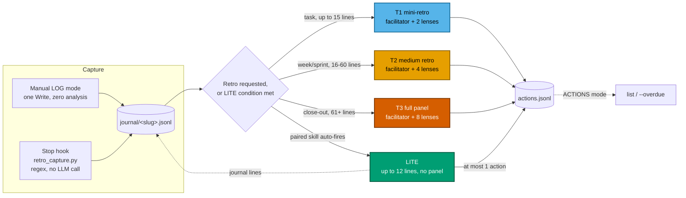

# retrospective

**Retros built from a journal of marked lines, where no lens reports a finding it cannot
point to.**

`retrospective` keeps an append-only journal per project and turns it into a retro run by a
fixed panel of lenses. Every finding needs an anchor (a journal line, a file, a diff or a
log entry), and a facilitator takes the quieter perspectives before the dominant one so the
first findings do not set the direction for the rest. Each retro ends with owned actions,
and the next retro starts by reconciling them, so retros build on each other. The journal is
filled by hand (LOG mode) or by a Stop hook that extracts marked lines from the transcript
without any model call.

| | |
|---|---|
| Protocol | v1.11 |
| Run it with | `/retrospective run <slug>` (also `log`, `actions` and `lite`) |
| Modes | LOG, RUN (tiers T1, T2 and T3), ACTIONS, LITE |
| Capture | by hand, or automatic through `scripts/retro_capture.py` (regex, standard library only) |
| Lenses | 8 standing lenses, each capped at 3 anchored findings |
| Depends on | nothing; LITE and the finance lens pair optionally with `critique` and `handoff` |

## Quick start

```bash
cp -r retrospective ~/.claude/skills/      # or ./install.sh retrospective from the repo root
```

During a session, write marked lines such as `DECISION: move the nightly job to 04:00 |
expect: no lock timeouts this week`. At the end of the week, run `/retrospective run
<project>` and the skill picks the tier from the number of journal lines.

## From a marked line to a panel finding

Each tier has its own colour, and LITE (green) is a separate path that a paired skill
triggers when its own condition fires.



Match the tier to the stakes. A T3 panel on a routine weekly check-in spends structure the
week does not need, and a T1 mini-retro on a project close-out leaves the questions that
need a debate unasked.

## Marker vocabulary

Five line types, each written at the start of a line (leading spaces or a bullet are fine):

```
DECISION: <text> | expect: <expected outcome>   (expect required)
EVENT: <text>
RESULT: <text>
FRICTION: <text>
WIN: <text>
```

The Stop hook takes `DECISION` lines only from what the user wrote, and takes the other four
from either side of the conversation. A `DECISION` with no `| expect:` clause anywhere in
the transcript is queued as a question, and the hook blocks the session's stop once so the
question can be asked before the session ends.

## Automatic capture with `scripts/retro_capture.py`

A `Stop` hook that uses the standard library only and makes no network or model call. The
same transcript always gives the same journal lines, so there is no invented marker to
audit for.

Register it in `settings.json`, merging into the `hooks` object if you already run other
hooks (entries merge across settings levels):

```json
{
  "hooks": {
    "Stop": [
      {
        "hooks": [
          { "type": "command", "command": "python3", "args": ["/absolute/path/to/skills/retrospective/scripts/retro_capture.py"], "timeout": 30 }
        ]
      }
    ]
  }
}
```

With `args` present, Claude Code runs `command` directly with no shell (the exec form in
the [hooks reference](https://code.claude.com/docs/en/hooks)). Use an absolute path in
`args`, since no shell expands a bare `~`, and paths with spaces need no quoting. On
Windows, set `command` to `python`, because exec form needs a real executable.

The hook writes one journal line per marker, at most 20 per session, to
`<project>/.claude/retro-log/journal/<slug>.jsonl`. `<project>` comes from
`$CLAUDE_PROJECT_DIR` or the hook's own `cwd`, and the slug defaults to the project folder
name (set `RETRO_SLUG` to override it). Claude Code fires `Stop` at the end of every turn,
so the hook deduplicates by session and skips any marker already written under the
current session id. A marker typed in the last turn of a long session is captured, and a marker
seen on ten turns is written once.

When a session's transcript holds no marker at all, the hook writes one `zero-extract` line
to `retro-log/capture-errors.log`. A hook that fires and writes nothing otherwise looks
exactly like a broken one, and that gap went unnoticed in this skill's own development
until hook v2.4 added the diagnostic (the hook is now at v2.5, with the history in its
module docstring).

## Storage

```
<project>/.claude/retro-log/
  journal/<slug>.jsonl      append-only capture, manual or hook-written, never rewritten
  actions.jsonl             one line per action; a status update appends a new line, last wins
  retros/<slug>-<date>.md   optional byte-identical copies; the originals go to <notes-root>/retros/
  questions/<slug>.jsonl    gaps only the user can settle, drained one at a time
  capture-errors.log        hook diagnostics: true failures and zero-extract firings
```

`global` is a reserved slug for a cross-project retro. It reads the invoking project's root,
as RUN does for every slug, and writes its document to `retros/` in that
project's notes folder.

## Ground rules for every RUN tier

The panel works under Kerth's Prime Directive, which assumes everyone did the best they
could with what they knew at the time. A decision is judged against its own `expect`
field, so a good decision with a bad outcome and a bad decision with a good outcome are each
named for what they were. Every finding needs an anchor (a journal line, a file, a diff or
a log entry), and a finding without one is dropped. A finding whose required change stays
unclear after brief examination is rewritten or dropped. Wins get the same weight as defects and are
named with the mechanism that produced them, so they can be repeated on purpose.

## ACTIONS and LITE modes

`actions [slug|all] [--overdue]` lists each action's latest status, sorted by due date, and
flags the overdue ones.

LITE is a bounded mini-retro that a review or handoff skill invokes. `references/lite.md`
holds the trigger test, which needs a second signal beyond recent journal activity (such as
a critique finding that recurs across runs, or a handoff whose PATTERN section is filled),
and the protocol: derive the slug, write up to 12 journal lines, append at most one action
and report back in one line. LITE never convenes the panel.

## Adapting this skill

### Capture

The hook is optional. LOG mode alone, with typed markers or a manual sweep at the end of a
session, is a complete way to use the skill.

### The finance lens

The finance lens anchors cost findings in whatever proxy data exists, as
`references/panel.md` sets out. It accepts the `critique` counters block as one source
without requiring `critique`, so you can point it at your own tooling's metrics or let it
fall back to timestamp-based timing.

### Personas and lenses

To add a persona, define it in your project config with a `name` and a `mandate`, following
the worked example at the bottom of `references/panel.md`. It competes for a lens slot under
the same rules as a standing lens (three findings at most, every one anchored). To change
the lens set, edit `references/panel.md`; each lens is a self-contained block of standing
questions.

## Files

```
SKILL.md                    LOG, RUN, ACTIONS and LITE modes, storage schema, ground rules
references/panel.md         facilitator protocol, 8 lenses and the project-persona extension point
references/lite.md          the LITE trigger test and protocol, for paired skills
references/formats.md       the retro document template
scripts/retro_capture.py    Stop hook: deterministic marker extraction, no model call
evals/evals.json            three regression cases, fixtures in evals/fixtures/
evals/results-2026-10.md    one run per case, with and without the skill, on an earlier version
```
